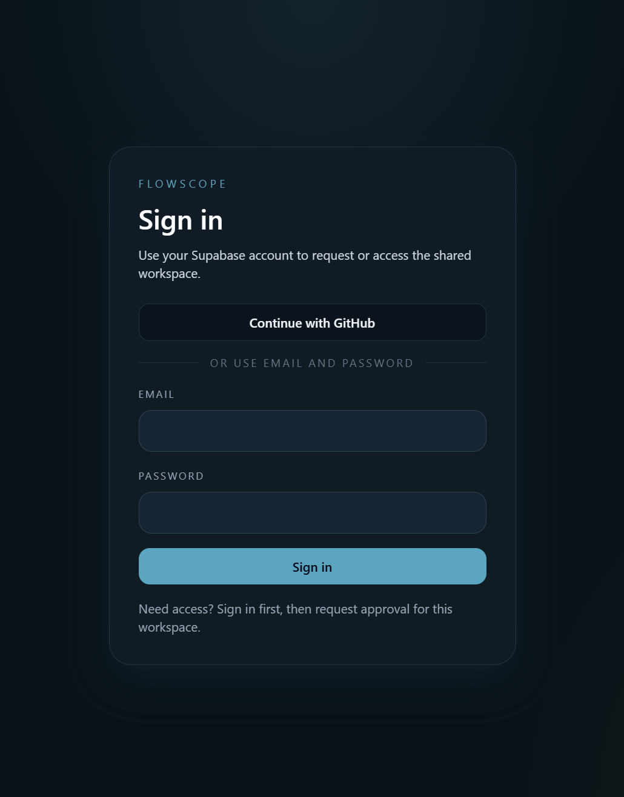

# 01 - Getting started

**Who:** Everyone

---

## Purpose

Get into FlowScope, request access if needed, and learn the workspace chrome so you can switch views confidently.

## Who

Anyone with a FlowScope login. Membership is separate from sign-in: you must be a **workspace member** before Monitor / Chart / Table data loads.

## When to use

- First time on the site
- After your password or GitHub account changes
- When you see the access request panel instead of Monitor

## Step by step

### Sign in

1. Open the FlowScope URL your team uses.
2. Sign in with **email and password**, or **GitHub**.
3. If login succeeds and you are a member, you land on the workspace. **Monitor** is the default view.

### Request access (non-members)

1. Sign in successfully.
2. If you are not a workspace member, you see the **access request** panel (not the graph).
3. Submit a request. Your session email is stored for Admin review.
4. Wait for an Admin/Superadmin to approve or reject ([11 - Admin](11-admin.md)).
5. If rejected, you can submit a new request.

Pending: you wait with a timestamp; you still cannot open Monitor/Chart/Table.

Screenshot pending — assets/access-request.png: Access request panel for signed-in non-members

### Orient in the workspace

1. Use the **view switcher** for Monitor, Chart, Table, and (Editor+) History.
2. Note the **status / controls** area (refresh, save state for editors, section label).
3. On Chart and Table, try **fullscreen**: the control is icon-only until hover/focus; while active it shows **Exit fullscreen**. Fullscreen hides the top chrome; on Chart it also hides both sidebars until you exit.
4. Drag sidebar edges to resize; widths and visibility are remembered in the browser (`localStorage`). Double-click a drag handle to reset width where available.
5. Admins open user management at **`/admin/users`** (not a workspace view tab).

Screenshot pending — assets/workspace-chrome.png: Navbar, view switcher, and status area

## Form / field standards

| Action | What to provide |
|--------|-----------------|
| Access request | No extra form fields beyond submit  -  email comes from your signed-in session |

## Edge cases

- **Signed in, no membership** → access request panel, not an empty Monitor.
- **No members in the workspace yet** → eligible users may see a link toward `/admin/users` to claim the first **Superadmin** (bootstrap). See [11 - Admin](11-admin.md).
- **History missing from the switcher** → your role is Viewer ([02](02-roles-and-permissions.md)).

## Related

- [02 - Roles and permissions](02-roles-and-permissions.md)
- [03 - Monitor](03-monitor.md)
- [11 - Admin](11-admin.md)
- [13 - FAQ](13-faq-and-troubleshooting.md)

